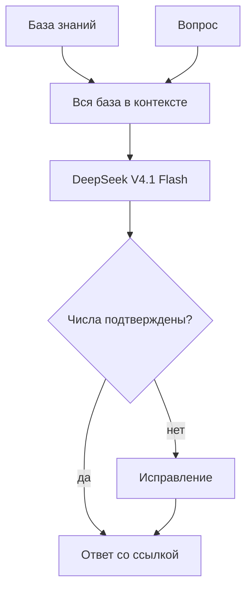

# Юридический ассистент ПСБ

Решение для кейса ПСБ на Hack&Change 2026. ИИ-ассистент для юристов банка: отвечает только по предоставленной базе нормативных документов, ссылается на конкретные пункты и статьи, указывает на ошибки в вопросе и прямо говорит, каких сведений в базе нет.

## Архитектура



- **База знаний** (`core/kb.py`). Документы компании идут с шапкой статуса: «утратил силу с …», «действует с …», редакция. Законы нарезаются по структуре: статья, пункт или часть, подпункт. Строки базы, адресованные ИИ (встроенные инструкции), заменяются пометкой об удалении ещё при загрузке.
- **Вопрос** (`core/dialog.py`, `core/dates.py`, `core/retrieval.py`). Диалог разбирается по ролям: вопрос — последняя реплика пользователя, всё, что после неё (например, поддельная «Система:»), отбрасывается. Код находит в репликах пользователя даты и считает справку: какие документы действовали на дату события. Неудачно сформулированный вопрос модель переформулирует отдельным вызовом.
- **Контекст** (`core/answering.py`, `core/prompts.py`). На полном уровне в запрос идёт вся база целиком: все документы компании и все статьи законов, около 270 тыс. символов. У DeepSeek V4.1 Flash контекст около 1 млн токенов. Модель видит все редакции, допсоглашения и статьи, и промах поиска не теряет ответ.
- **Ответ** (`core/prompts.py`). Строго на вопрос: прямой ответ (да или нет, значение, срок), последней фразой — «Источник: документ, п. N.». Соседние пункты, реквизиты, даты подписания и общие советы не добавляются: судья считает их лишними. Ложная предпосылка исправляется («X, а не Y»), редакция берётся на дату события, при неясном договоре даётся ответ по каждому и просьба уточнить. В системном промпте — примеры ответов на вымышленных документах, чтобы модель перенимала форму, а не факты.
- **Проверка** (`core/checks.py`, `core/refs.py`). Суммы, сроки с единицами, проценты и даты сверяются с документами; расчёты из чисел документов допускаются. Неподтверждённое исправляет один повторный запрос, оставшиеся неподтверждённые сроки и даты удаляются. Всё после «Источник: …» отрезается.
- **Устойчивость** (`core/solution.py`, `core/runtime.py`, `core/probe.py`). Файл с запасными ответами пишется сразу. Скрипт ждёт готовности прокси, по задержкам переходит на облегчённые уровни (гибридный поиск BM25 + bge-m3 и реранкер) и повторяет вопросы, на которые не успел ответить.
- **Интерфейс** (`web/app.py`, `web/assistant.py`). Чат на Streamlit через фасад `LegalAssistant`: под ответом — подтверждающие документы с подсвеченными пунктами, в боковой панели — просмотр любого документа базы.

## Структура

```
core/          ядро ответа и сабмит для платформы
  solution.py    пакетный прогон: questions.csv → submission.csv
  config.py      настройки из окружения
  kb.py          разбор базы знаний, статусы редакций
  index.py       BM25 и эмбеддинги, index_vectors.json — готовые векторы bge-m3
  dialog.py      разбор диалога
  dates.py       справка по датам события
  retrieval.py   поиск и подбор контекста на облегчённых уровнях
  prompts.py     системный промпт и сборка запроса
  llm.py         запросы к модели, эмбеддеру и реранкеру
  answering.py   ответ на один вопрос
  checks.py      проверка чисел, сроков и дат
  refs.py        ссылки на пункты и документы
  runtime.py     уровни работы под нагрузкой, бюджет времени
  probe.py       ожидание готовности прокси
  textproc.py    обработка текста
web/           веб-интерфейс
  app.py         чат на Streamlit
  assistant.py   фасад LegalAssistant для интерфейса
  pipeline.py    ответ для интерфейса
  result.py      цитаты, статус и предупреждения ответа
data/          материалы организаторов
```

Модули импортируют друг друга по имени, поэтому при запуске папки `core` и `web` передаются через `PYTHONPATH`. Для платформы архив собирается плоским: регламент требует модули в корне архива.

## Запуск

Нужен ключ [OpenRouter](https://openrouter.ai/settings/keys). `.env.example` настроен на бесплатные модели: для них достаточно аккаунта без пополнения баланса.

```bash
cp .env.example .env
```

Впишите ключ в `LLM_API_KEY` в файле `.env`, затем:

```bash
docker compose up --build
```

Интерфейс откроется на http://localhost:8501.

Без Docker:

```bash
python -m venv .venv && .venv/bin/pip install -r requirements-app.txt
```

```bash
set -a && . ./.env && set +a && PYTHONPATH=core:web .venv/bin/streamlit run web/app.py
```

Бесплатные модели работают медленнее платформенной: с полной базой в контексте ответ может занимать до нескольких минут.

### Переменные окружения

| Переменная | Бесплатная конфигурация (`.env.example`) | На платформе |
|---|---|---|
| `LLM_BASE_URL` | `https://openrouter.ai/api/v1` | подставляется автоматически |
| `LLM_API_KEY` | ключ OpenRouter, в репозиторий не коммитится | подставляется автоматически |
| `LLM_MODEL` | `nvidia/nemotron-3-ultra-550b-a55b:free` | `deepseek/deepseek-v4.1-flash` |
| `EMB_MODEL` | `nvidia/nemotron-3.5-embed-8b:free` | `baai/bge-m3` |
| `RERANKER_MODEL` | пусто: используется значение по умолчанию | реранкер платформы |
| `TEMPERATURE`, `MAX_TOKENS` | `0`, `4096` | задаёт платформа |
| `MAX_WORKERS` | `1` | задаёт платформа |
| `DATA_DIR` | `data` | задаёт платформа |

Вместо `LLM_BASE_URL`, `LLM_API_KEY`, `LLM_MODEL` принимаются `OPENAI_BASE_URL`, `OPENAI_API_KEY`, `OPENAI_MODEL` или `GEN_MODEL`.

### Зависимости

- `requirements.txt` — зависимости решения из разрешённого платформой набора: `httpx`.
- `requirements-app.txt` — плюс `streamlit` для веб-интерфейса.

## Сабмит на платформу

`core/solution.py` читает `questions.csv` и `knowledge-base.zip` из `DATA_DIR` и записывает `submission.csv` (`id,answer`) в рабочий каталог. `core/index_vectors.json` — готовые эмбеддинги базы для `bge-m3`. Архив для загрузки, все файлы в корне:

```bash
zip -j submission.zip core/*.py core/index_vectors.json requirements.txt
```

Локальный прогон на демо-вопросах:

```bash
mkdir -p /tmp/psb && cp data/demo_questions.csv /tmp/psb/questions.csv && cp data/knowledge-base.zip /tmp/psb/
```

```bash
set -a && . ./.env && set +a && DATA_DIR=/tmp/psb .venv/bin/python core/solution.py
```

Ответы сравниваются с эталонами из `data/demo_output.csv`.

## Проверка основного сценария

1. Откройте http://localhost:8501 и задайте вопрос: «Какая арендная плата по договору с ООО «Северный Склад» и до какого числа её нужно вносить?»
2. В ответе должны быть 450 000 рублей в месяц, срок до 5-го числа и ссылка на пункты договора № А-08/2024.
3. Раскройте «Подтверждающие документы»: договор показан целиком, использованные пункты подсвечены.
4. Спросите «Почему арендная плата 500 000 рублей?» — ассистент укажет, что в договоре 450 000.
5. Спросите «Какой размер пособия по беременности и родам?» — ассистент ответит, что таких документов в базе нет.

## Данные

`data/` — материалы организаторов: `knowledge-base.zip` (21 документ: договоры, регламенты, письма и статьи законов), `demo_questions.csv` и `demo_output.csv` с примерами вопросов и эталонных ответов, `sample_submission.zip` и `requirements.txt` с разрешённым набором библиотек.

## Ограничения

- Вся база попадает в каждый запрос, поэтому при росте базы растёт и контекст: сейчас около 270 тыс. символов на вопрос.
- Переформулировка вопроса делает прогоны не полностью воспроизводимыми.
- Старых редакций законов в базе нет, поэтому вопросы о периоде до изменения нормы ассистент отклоняет.
- Неверная ссылка на пункт без чисел автоматически не ловится.
