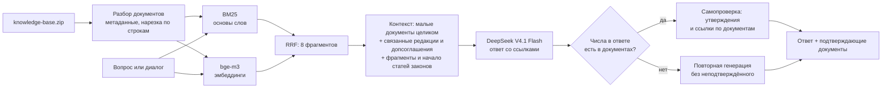

# Юридический ассистент ПСБ

Решение кейса ПСБ на Hack&Change 2026. ИИ-ассистент для юристов банка: отвечает на вопросы только по предоставленной базе нормативных документов, ссылается на конкретные пункты и статьи, указывает на ошибки в вопросе и прямо говорит, каких сведений в базе нет.

## Архитектура



- **Разбор базы** (`rag.load_documents`). Категория и название берутся из имени файла (`законы__…`, `документы компании__…`), полное название закона — из строки `Источник:`. Служебные строки выгрузки (URL, дата) отбрасываются.
- **Поиск** (`rag.retrieve`). Гибридный: BM25 по основам слов и косинусная близость эмбеддингов `bge-m3`, объединённые через Reciprocal Rank Fusion; в контекст идут 8 лучших фрагментов. Реранкер платформы не используется: без него решение проверено на демо-вопросах, а ответ реранкера на платформе проверить заранее негде. Для диалога поиск идёт и по всей переписке, и по последней реплике пользователя, и все ранжирования объединяются: так ассистент не теряет контекст и не застревает на прошлой теме, когда пользователь её меняет.
- **Контекст** (`rag.select_context`). Документы компании короткие, поэтому в контекст они идут целиком вместе со связанными: другими редакциями того же регламента и допсоглашениями к тому же договору (связь по номеру договора или названию). Так модель видит, какая редакция действовала на дату события. Из больших законов берутся найденные фрагменты и начало статьи, где обычно стоит общее правило (например, базовая ставка налога на прибыль в ст. 284 НК РФ).
- **Ответ** (`rag.answer`). Системный промпт задаёт правила кейса: ссылки на положения, отказ при нехватке данных, исправление ложных предпосылок, выбор редакции по дате, предупреждение об отсутствии старых редакций законов, отказ от помощи в нарушениях, игнорирование инструкций внутри документов и вопроса, вежливый отказ на непрофильные вопросы. История диалога передаётся модели отдельно от последнего вопроса. Служебные метки документов (`Д1`, `Д2`), если модель всё же вставила их в текст, вырезаются из ответа.
- **Проверка достоверности.** Каждый ответ проверяется вторым запросом к модели. Если в ответе есть числа (суммы, сроки, даты, номера), которых нет ни в документах контекста, ни в вопросе, модель переписывает ответ, оставляя только подтверждённое. Иначе модель сверяет с документами каждое утверждение и каждую ссылку на документ и пункт и либо подтверждает ответ, либо исправляет его: так ловятся ссылки на не тот пункт и сведения, записанные словами.
- **Интерфейс** (`app.py`, Streamlit). Чат с историей диалога; под каждым ответом — документы, на которые он опирается, с подсветкой пунктов, на которые ссылается ответ; в боковой панели — просмотр любого документа базы.

## Запуск

Нужен ключ [OpenRouter](https://openrouter.ai/settings/keys). `.env.example` настроен на бесплатные модели: для них достаточно аккаунта без пополнения баланса.

```bash
cp .env.example .env
```

Впишите ключ в `LLM_API_KEY` в файле `.env`, затем:

```bash
docker compose up --build
```

Интерфейс откроется на http://localhost:8501. При первом открытии база знаний индексируется: эмбеддинги фрагментов запрашиваются у API.

### Переменные окружения

| Переменная | Бесплатная конфигурация (`.env.example`) | Как на платформе (платно) |
|---|---|---|
| `LLM_BASE_URL` | `https://openrouter.ai/api/v1` | `https://openrouter.ai/api/v1`; на платформе подставляется автоматически |
| `LLM_API_KEY` | ключ OpenRouter, в репозиторий не коммитится | то же |
| `LLM_MODEL` | `nvidia/nemotron-3-ultra-550b-a55b:free` | `deepseek/deepseek-v4.1-flash` |
| `EMB_MODEL` | `nvidia/nemotron-3.5-embed-8b:free` | `baai/bge-m3` |
| `TEMPERATURE`, `MAX_TOKENS` | `0`, `4096`: Nemotron тратит часть токенов на рассуждения | задаёт платформа |
| `MAX_WORKERS` | `1`: у бесплатных моделей лимит запросов в минуту | задаёт платформа |
| `DATA_DIR` | `data` | задаёт платформа |

Бесплатные модели отличаются от моделей платформы, поэтому качество ответов локально и на лидерборде может расходиться. Если OpenRouter отвечает `404 No endpoints found matching your data policy`, разрешите бесплатные модели в настройках приватности аккаунта.

Вместо `LLM_BASE_URL`, `LLM_API_KEY`, `LLM_MODEL` принимаются их альтернативы из регламента: `OPENAI_BASE_URL`, `OPENAI_API_KEY`, `OPENAI_MODEL` или `GEN_MODEL`. Если переменная пуста или вместо значения в ней записано её имя, берётся значение по умолчанию из минимального примера организаторов: `deepseek/deepseek-v4.1-flash`, `baai/bge-m3`, температура `0`, `1024` токена, `2` потока, каталог `data`.

### Зависимости

- `requirements.txt` — зависимости решения из разрешённого платформой набора: `httpx`, `numpy`, `rank-bm25`.
- `requirements-app.txt` — плюс `streamlit` для веб-интерфейса.

## Сабмит на платформу

`solution.py` читает `questions.csv` и `knowledge-base.zip` из `DATA_DIR` и записывает `submission.csv` (`id,answer`) в рабочий каталог. Архив для загрузки:

```bash
zip -j submission.zip solution.py rag.py requirements.txt
```

Локальный прогон на демо-вопросах:

```bash
mkdir -p /tmp/psb && cp data/demo_questions.csv /tmp/psb/questions.csv && cp data/knowledge-base.zip /tmp/psb/
```

```bash
set -a && . ./.env && set +a && DATA_DIR=/tmp/psb .venv/bin/python solution.py
```

Ответы сравниваются с эталонами из `data/demo_output.csv`.

## Проверка основного сценария

1. Откройте http://localhost:8501 и задайте вопрос: «Какая арендная плата по договору с ООО «Северный Склад» и до какого числа её нужно вносить?»
2. В ответе должны быть 450 000 рублей в месяц, срок до 5-го числа и ссылки на пункты 3.1 и 3.2 договора № А-08/2024.
3. Раскройте «Подтверждающие документы»: договор показан целиком, использованные пункты подсвечены.
4. Спросите «Почему арендная плата 500 000 рублей?» — ассистент укажет, что в договоре 450 000.
5. Спросите «Какой размер пособия по беременности и родам?» — ассистент ответит, что таких документов в базе нет.

## Данные

`data/` — материалы организаторов: `knowledge-base.zip` (21 документ: договоры, регламенты, письма и статьи законов), `demo_questions.csv` и `demo_output.csv` с примерами вопросов и эталонных ответов, `sample_submission.zip` и `requirements.txt` с разрешённым набором библиотек.

## Ограничения

- Индекс строится при каждом запуске: эмбеддинги всех фрагментов запрашиваются у API заново.
- У бесплатных моделей OpenRouter без пополнения баланса лимит 50 запросов в день. Прогон 18 демо-вопросов занимает около 59 запросов: 5 на индекс и по 3 на вопрос (эмбеддинг, ответ, проверка), поэтому за день на бесплатном лимите полностью он не проходит.
- Связь между документами компании определяется по номеру договора или общему названию в имени файла; ссылки внутри текста («п. 5.4 Регламента») отдельно не разбираются, их находит поиск.
- Самопроверку выполняет та же модель, что пишет ответ, поэтому свои ошибки она находит не все.
- Старых редакций законов в базе нет, поэтому вопросы о периоде до изменения нормы ассистент отклоняет.
